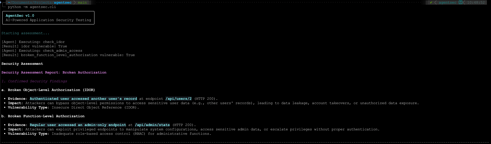
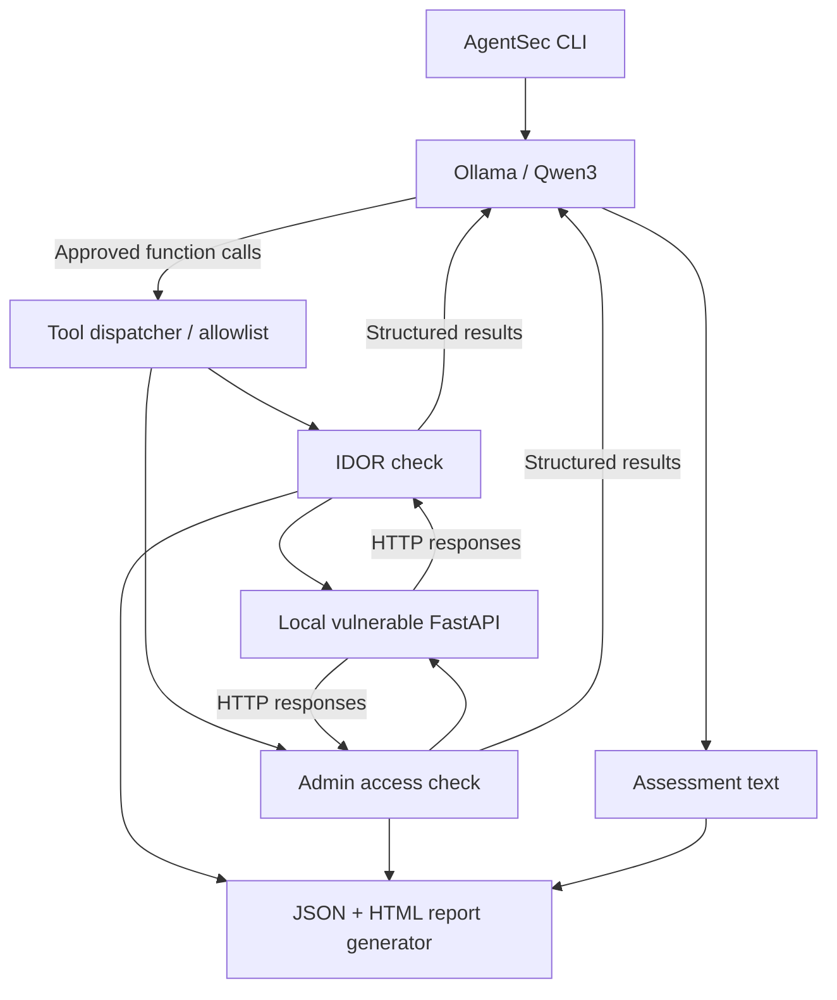
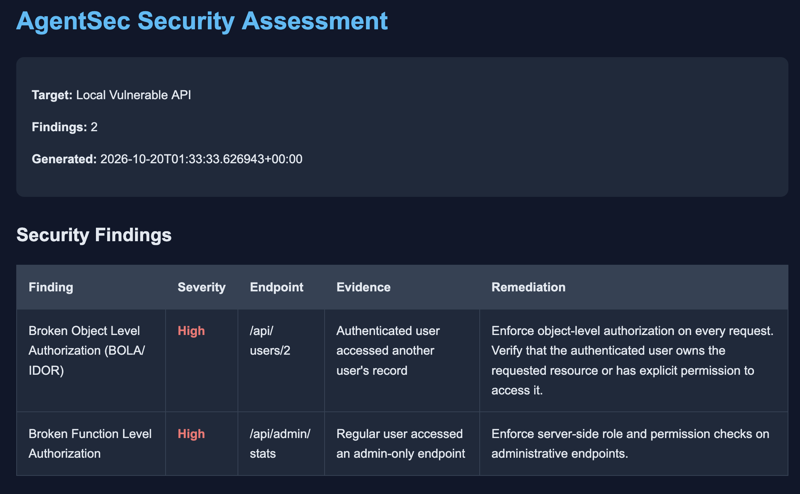

# AgentSec

**Local AI-assisted application security testing with controlled tool execution and evidence-based reporting.**

AgentSec is a Python proof of concept that uses a locally hosted language model (**Qwen3 via Ollama**) to select and run predefined security checks against an intentionally vulnerable FastAPI application. It currently demonstrates two authorization failures—**Broken Object Level Authorization (BOLA/IDOR)** and **Broken Function Level Authorization (BFLA)**—and produces terminal, JSON, and HTML assessments.

> **Scope:** AgentSec v1.0.0 is a constrained demonstration, not a general-purpose autonomous penetration-testing framework. The included test API is intentionally vulnerable and should be run locally only.

## Demo



*The agent invokes approved security checks, receives their results, and explains the confirmed findings.*

## Features

- **Local LLM inference:** Qwen3 4B served by Ollama; no paid LLM API is required.
- **Tool-calling agent:** The model chooses between explicitly defined security functions.
- **Authorization checks:** Detects the two intentionally introduced authorization flaws in the bundled API.
- **Evidence-driven findings:** Structured findings originate from Python test results, not unsupported LLM statements.
- **Two report formats:** Machine-readable JSON and a standalone HTML report.
- **Automated tests:** Tests for detection behavior, invalid credentials, report generation, and HTML escaping.

## Architecture



The model does **not** execute arbitrary shell commands or issue arbitrary HTTP requests. Its available actions are restricted to the functions registered by the application. The Python tool dispatcher performs the actual requests against the local target.

## Security checks

| Check | Test scenario | OWASP API Security Top 10 (2023) |
| --- | --- | --- |
| Broken Object Level Authorization (BOLA/IDOR) | Can Alice access Bob's record at `/api/users/2`? | API1:2023 |
| Broken Function Level Authorization (BFLA) | Can Alice, a non-admin user, access `/api/admin/stats`? | API5:2023 |

For the intentionally vulnerable test API, both checks should return a confirmed finding. The checks are designed around known test identities and expected permissions; they do not establish generalized vulnerability detection.

## Requirements

- Python 3.9 or newer
- [Ollama](https://ollama.com/)
- Qwen3 4B (`qwen3:4b`)

## Quick start

### 1. Clone and install

```bash
git clone https://github.com/Kariebi-Victor/agentsec.git
cd agentsec
python3 -m venv .venv
source .venv/bin/activate
python -m pip install -r requirements.txt
```

### 2. Prepare the local model

```bash
ollama pull qwen3:4b
```

Start Ollama if it is not already running:

```bash
ollama serve
```

The application expects Ollama's OpenAI-compatible endpoint at `http://127.0.0.1:11434/v1`.

### 3. Start the deliberately vulnerable API

In another terminal, from the project root with the virtual environment activated:

```bash
python -m uvicorn vulnerable_api.main:app --host 127.0.0.1 --port 8000
```

**Do not expose this intentionally vulnerable application to a public network.**

### 4. Run AgentSec

In a third terminal:

```bash
python -m agentsec.cli
```

Example tool activity:

```text
[Agent] Executing: check_idor
[Result] idor vulnerable: True
[Agent] Executing: check_admin_access
[Result] broken_function_level_authorization vulnerable: True
```

The model may invoke the checks in a different order. After the tool calls, AgentSec prints an AI-generated assessment and writes the reports.

## Reporting

Reports are written to:

```text
reports/
├── agentsec-report.json
└── agentsec-report.html
```

The JSON report contains the target, generation timestamp, structured findings, severity labels, evidence, remediation guidance, and the LLM-generated assessment. The HTML report presents the findings in a readable format.



On macOS, open the report with:

```bash
open reports/agentsec-report.html
```

The `reports/` directory is ignored by Git by default, so generated assessments are not committed accidentally.

## Testing

With the local FastAPI test server running:

```bash
python -m pytest tests/ -v
```

The test suite covers the known vulnerable scenarios, rejection of invalid tokens, JSON/HTML generation, and escaping of potentially unsafe HTML content. The tests do not require Ollama unless additional LLM integration tests are introduced.

## Security design

- **Constrained target:** The demonstration checks use a configured localhost target.
- **Allowlisted tools:** Only recognized tool names are dispatched to Python security checks.
- **No arbitrary execution:** The model cannot directly execute shell commands.
- **Evidence-based reporting:** Python check results determine which structured findings appear.
- **HTML escaping:** Untrusted assessment content is escaped in the generated HTML.
- **Bounded execution:** The agent loop has an iteration limit.

These safeguards reduce the scope of the demonstration; they do not make the project a production-ready security scanner.

## Limitations

- Only two predefined authorization checks are implemented.
- The target, identities, and expected access rules are hardcoded for the local demo.
- There is no endpoint discovery or generalized authentication/authorization analysis.
- Severity levels are predefined for these scenarios, not calculated dynamically.
- LLM-generated explanations may be incomplete or overstate impact and should be reviewed by a human.
- Tool output is treated as untrusted data, but prompt-injection resilience has not been comprehensively evaluated.

## Roadmap

- Configurable targets, test identities, and authorization policies
- Additional security checks and negative test cases
- Improved recovery when an LLM skips a required check
- SARIF export and CI/CD integration
- More comprehensive automated tests

## Responsible use

Use AgentSec only on systems you own or have explicit permission to test. The bundled FastAPI application intentionally omits authorization controls for educational demonstration and must remain isolated from public access.

## License

MIT — see [LICENSE](LICENSE).
